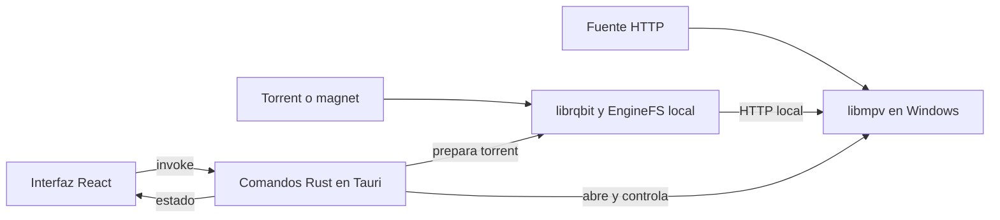

# Arquitectura de Aetherio Mobile

Esta explicacion esta pensada para quien empieza a leer el proyecto.
Su objetivo es entender como se conectan las piezas y donde estan los limites,
no dar instrucciones de instalacion ni prometer que ya existe una app Android.

**Estado actual:** el fork parte de una aplicacion de escritorio para Windows.
La preparacion Android introduce deteccion de plataforma, protecciones para
operaciones de ventanas y actualizaciones, y configuracion de Vite.
No hay un proyecto Android generado en `src-tauri/gen/android` ni se acredita
aqui un APK funcional. El backend de reproduccion sigue dependiendo de Windows.

## 1. Las tres piezas principales

**React** construye lo que ves: inicio, busqueda, fichas, perfiles y controles.
El codigo esta escrito principalmente en TypeScript dentro de `src/`.
Una pantalla organiza datos y acciones; no es por si misma el motor de video.

**Tauri** es el contenedor nativo y el puente entre la interfaz y el sistema.
Muestra la interfaz en una WebView, una vista que interpreta HTML, CSS y JavaScript.
Que Tauri admita aplicaciones moviles no convierte automaticamente este backend
de Windows en uno compatible con Android.

**Rust** implementa los comandos nativos dentro de `src-tauri/src/`.
Gestiona, entre otras cosas, mpv, el motor torrent y servicios HTTP locales.
En este contexto, "backend" significa codigo dentro de la aplicacion,
no necesariamente un servidor remoto de Aetherio.

El siguiente esquema resume el camino de reproduccion **de escritorio**.
Las flechas representan solicitudes y datos; el video no atraviesa React.

## 2. Como una accion llega a Rust

El arranque de React esta en [main.tsx](../../src/main.tsx).
[App.tsx](../../src/App.tsx) coordina rutas, sesion, perfiles y preparacion del inicio.
El lector puede imaginar cada ruta como una pantalla con una responsabilidad.

Cuando la interfaz necesita una funcion nativa, usa un comando con nombre.
`invoke` es una llamada asincrona: envia argumentos a Rust y recibe un resultado
o un error, sin convertir el codigo Rust en codigo del navegador.

Por ejemplo, al abrir una fuente de video ocurre esta secuencia:

1. La interfaz obtiene una fuente y prepara su destino, subtitulos y cabeceras.
2. [Player/utils.ts](../../src/pages/Player/utils.ts) llama a `openNativePlayback`.
3. [platform.ts](../../src/runtime/platform.ts) traduce esa llamada a `invokeCommand("open_mpv", ...)`.
4. `invokeCommand` delega en `invoke`, la API de Tauri.
5. [lib.rs](../../src-tauri/src/lib.rs) registra y ejecuta el comando Rust `open_mpv`.
6. Rust devuelve el resultado; la interfaz consulta estado y envia controles.

Este recorrido es una frontera importante: mostrar un boton en React no garantiza
que su comando nativo exista o funcione en otra plataforma.
Ademas, `invokeCommand` no simula un backend cuando se abre la interfaz en un navegador.

## 3. Catalogo no significa archivo de video

El catalogo describe obras: titulo, portada, resumen, temporadas e identificadores.
Una fuente de reproduccion indica de donde se obtendran los bytes del video.
Por eso una ficha puede cargar aunque ninguna fuente este disponible.

[useCatalogs.ts](../../src/hooks/useCatalogs.ts) combina datos de servicios como
TMDB, AniList, Jikan y catalogos de complementos, segun configuracion.
React Query ayuda a reutilizar resultados de consultas; el cache persistente del
inicio permite mostrar una instantanea anterior mientras se actualizan los datos.
No equivale a descargar peliculas ni asegura un catalogo completo sin conexion.

[addonStore.ts](../../src/store/addonStore.ts) mantiene los complementos y sus
manifiestos. Un manifiesto describe recursos disponibles, como catalogos o fuentes.
[useStreams.ts](../../src/hooks/useStreams.ts) consulta fuentes de complementos,
adapta identificadores y elimina duplicados.

Existe tambien una via de proveedores y extraccion de enlaces, coordinada por
[useScrapedStreams.ts](../../src/hooks/useScrapedStreams.ts).
[scraperService.ts](../../src/services/scraperService.ts), por ejemplo, llama al
comando Rust `scrape_streams`. No todas las consultas de red pasan por Rust:
tambien hay peticiones `fetch` desde TypeScript.

Los servicios externos pueden fallar, limitar peticiones o cambiar sus respuestas.
Reutilizar esta logica en Android exigira revisar red, permisos y dependencias;
la presencia de los proveedores en el repositorio no prueba soporte movil.

## 4. Donde se guardan los datos

Conviene distinguir estado en memoria, datos persistentes y credenciales.
Los primeros ayudan a dibujar la pantalla; los segundos sobreviven a un reinicio;
las credenciales necesitan proteccion adicional, no solo persistencia.

- [localProfiles.ts](../../src/utils/localProfiles.ts) guarda perfiles y perfil activo en `localStorage`.
- [cacheStore.ts](../../src/store/cacheStore.ts) conserva una instantanea limitada del inicio con Zustand y `localStorage`.
- [continueWatching.ts](../../src/utils/continueWatching.ts) conserva progreso y selecciones para continuar viendo.
- [addonStore.ts](../../src/store/addonStore.ts) distingue complementos globales y del perfil.
- [tmdb_text_cache.rs](../../src-tauri/src/tmdb_text_cache.rs) mantiene un cache de texto en el directorio de datos de la aplicacion.

`localStorage` es almacenamiento de la interfaz en ese dispositivo y contexto.
El perfil local agrupa nombre, avatar, PIN opcional y datos asociados.
Algunas claves usan el identificador del perfil para separar preferencias y progreso;
no todo es privado de cada perfil, pues tambien hay configuracion global.

Un perfil local no es una cuenta remota ni implica sincronizacion entre equipos.
El codigo heredado incluye cuentas e integraciones como Trakt y AniList,
pero eso no demuestra que el inicio de sesion o la sincronizacion funcionen en Android.
Tampoco hay que asumir que los datos de Windows apareceran en el movil.

### Credenciales y seguridad

[secureCredentialStore.ts](../../src/auth/secureCredentialStore.ts) usa comandos
nativos cuando detecta el almacen de credenciales de Windows.
Fuera de esa deteccion tiene una alternativa basada en `localStorage`.
[secure_credentials.rs](../../src-tauri/src/secure_credentials.rs) implementa el
almacen seguro para Windows; sus comandos devuelven error en otras plataformas.

Por tanto, no hay aqui un almacen seguro Android equivalente implementado.
`localStorage` y el PIN de seleccion de perfil no cifran todos los datos guardados.
Antes de habilitar cuentas en Android hay que resolver almacenamiento seguro,
retorno de autenticacion y tratamiento de tokens. No se deben publicar secretos,
cabeceras de autorizacion ni enlaces privados en documentos o registros compartidos.

## 5. Como se reproduce en escritorio

Una fuente puede contener una URL HTTP, un magnet o informacion de un torrent.
[Player/utils.ts](../../src/pages/Player/utils.ts) prepara el destino y las
cabeceras necesarias; Rust recibe la solicitud mediante el puente explicado antes.

Para HTTP, el backend entrega a mpv el destino y las opciones de reproduccion.
Para torrent, `librqbit` gestiona la obtencion de datos y la seleccion del archivo.
[enginefs.rs](../../src-tauri/src/p2p/enginefs.rs) ofrece una interfaz HTTP local
para que mpv pueda leer ese contenido. No es un nuevo motor torrent.
La [referencia EngineFS](../ENGINEFS_P0.md) detalla ese contrato interno.
Los torrents privados se bloquean actualmente en `open_mpv` por falta de aislamiento sin DHT.

El motor actual es **libmpv cargado dentro del proceso Tauri**, no un reproductor
HTML ni un `mpv.exe` externo. Requiere `libmpv-2.dll` y sus dependencias, y usa la
ventana nativa de Windows para mostrar video, como explica el
[README del runtime mpv](../../src-tauri/bin/mpv/README.md).

`playback_capabilities` declara el backend y formatos y comprueba si encuentra la DLL.
Eso no verifica que cada codec, fuente o funcion funcione en un dispositivo.
Los formatos anunciados no constituyen una matriz de compatibilidad Android.
Ademas, el backend puede permitir transporte HTTP sin cifrar; una URL inicialmente
HTTPS no garantiza que toda la cadena de reproduccion permanezca cifrada.

Los posters son otra dependencia distinta del video.
[poster_server.rs](../../src-tauri/src/poster_server.rs) busca `node.exe` para
arrancar el servicio local de SpatialPosters en escritorio.
El empaquetado de [tauri.conf.json](../../src-tauri/tauri.conf.json) incluye ese
runtime y los recursos mpv: ninguno se transforma en binario Android por reutilizar React.

## 6. Que se conserva y que debe cambiar para Android

La separacion por capas permite conservar ideas y parte del codigo, pero no
garantiza que todas las pantallas o servicios sean portables sin ajustes.

| Pieza | Base aprovechable | Limite o trabajo futuro Android |
| --- | --- | --- |
| Interfaz y catalogo | Componentes React, modelos y consultas | Adaptar tactil, tamanos y comportamiento movil; validar red. |
| Puente nativo | Solicitudes y resultados entre UI y Rust | Implementar o adaptar cada comando necesario. |
| Perfil y progreso | Modelo local y separacion de claves | Revisar persistencia, migracion y seguridad en el dispositivo. |
| Video | Intencion de abrir, pausar y consultar estado | Sustituir o adaptar el backend Windows y su superficie nativa. |
| Torrent | Logica Rust y contrato HTTP local | Evaluar compilacion, almacenamiento, consumo y ciclo de vida movil. |
| Posters | Datos e imagenes que consume la UI | Replantear el servidor que hoy requiere `node.exe`. |
| Ventanas y updater | Comportamiento desktop existente | Usar mecanismos moviles propios, no las operaciones de Windows. |

Media3/ExoPlayer es una **propuesta** para sustituir el reproductor en Android,
no una implementacion presente. Elegirlo requeriria un puente nativo y adaptar
estado, pistas, subtitulos y ciclo de vida; no basta con cambiar un nombre.

## 7. Mapa de la preparacion actual

Estos archivos permiten localizar los cambios sin confundir preparacion con soporte:

| Archivo | Responsabilidad actual |
| --- | --- |
| [platform.ts](../../src/runtime/platform.ts) | Distingue `web`, `desktop` y `android`; protege varias operaciones exclusivas de escritorio. |
| [StartupExperience.tsx](../../src/components/startup/StartupExperience.tsx) | Reserva la coordinacion de ventanas de arranque al runtime desktop. |
| [UpdatePopup.tsx](../../src/components/updater/UpdatePopup.tsx) | Evita iniciar la consulta automatica del updater fuera de desktop. |
| [vite.config.ts](../../vite.config.ts) | Expone `TAURI_ENV_PLATFORM` y configura host/HMR usando `TAURI_DEV_HOST`. |
| [Cargo.toml](../../src-tauri/Cargo.toml) | Declara dependencias Rust; varias dependencias nativas estan restringidas a Windows. |
| [lib.rs](../../src-tauri/src/lib.rs) | Registra comandos y contiene el backend que aun necesita adaptacion. |

Sin Tauri, la deteccion devuelve `web`, incluso en un navegador Android.
Con Tauri, prioriza `TAURI_ENV_PLATFORM` y usa el agente del navegador como alternativa.
Las protecciones no sustituyen el backend: `openNativePlayback` aun invoca `open_mpv`.

Quedan pendientes el proyecto Android generado, el motor de video, los servicios
dependientes de Windows, el almacenamiento seguro y la validacion en dispositivo.
Esta explicacion se basa en lectura del repositorio: no acredita builds, tests,
firmas, hashes verificados ni una APK ejecutada.
